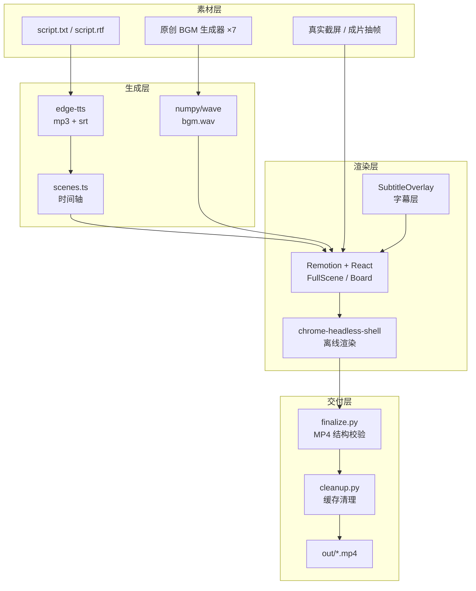

# 01 · 全景与成果

## 一句话

用**两天**，把"我想给家长做一个陪看讲解视频"变成一套**可复用、可离线、零版权素材风险**的流水线，并完成 10 条成片。

## 时间线（真实文件时间戳）

| 阶段 | 产出 | 关键决定 |
|---|---|---|
| Day 1 上午 | 零成本方案调研 | 确认 Remotion + edge-tts + 原创 BGM 全链路 ¥0 |
| Day 1 中午 | `workbuddy-intro` 第一条样片 | 摸清沙箱兼容点：浏览器路径、临时目录补丁、finalize 兜底 |
| Day 1 下午 | `pawpatrol-s1` 第 1 季指南 | 定下"emoji + 色块 + AI 旁白 + 原创 BGM"的版权安全路线 |
| Day 2 上午 | 8 位队友 / 1–6 季 / 地图动画 | 抽出 `new-episode.sh` 模板，第二条起边际成本骤降 |
| Day 2 下午 | 5 分钟版 × 3 + 成人向拆解 | 长视频改为"元数据表 + 8 类通用版式"，不再手写镜头文件 |
| Day 2 晚上 | BGM 七版迭代 + 工具层 | 固化依赖、CLI 与 BGM prompt SOP |
| Day 3 | 11 分钟复盘片 | 加入真实截屏与真实成片画面，验证"证据式叙事" |

## 成果（脚本直读 MP4 元数据）

| 指标 | 数值 |
|---|---|
| 成片数量 | **10 条** |
| 总时长 | **34.6 分钟** |
| 总体积 | **142.6 MB** |
| 原创 BGM 版本 | **7 版**（进行曲 / 民乐 / 弦乐 / 抓耳 / 摇滚 / 旋律重塑 / 童声合唱） |
| 统一 CLI 命令 | **8 个**（doctor / new / build / offline / audio / bgm / analyze / clean） |
| 复盘片 | **51 段口播 / 11 分 12 秒 / 43.5 MB** |

> 统计方式：`mutagen.mp4.MP4` 读取每个 `*/out/*.mp4` 的 `info.length` 与文件大小，非人工估算。

## 技术架构

## 三层复用结构

1. **共享工具层 `video-toolkit/`**：一次安装，所有工程复用。Python 包版本固定；`doctor` 通过就不再重复安装。
2. **模板工程 `pawpatrol-s1/`**：新一集从它复制，自动软链 `node_modules`、参数化输出名、写入语速档位。
3. **单集工程**：只保留自己的 `script.txt`、`board.ts`、配音与画面数据；`src/data/scenes.ts` 自动生成，禁止手改。

## 为什么这套方法值得复制

- **边际成本低**：第一条摸清所有坑，第二条起只需改脚本文案与画面数据。
- **断网可用**：配音落地后，渲染、调色、换 BGM 全部本地完成。
- **版权干净**：不使用官方 Logo、角色形象、原片或主题曲；音乐为数学合成，不采样真人录音。
- **可交接**：任何 AI 工具只要 `source env.sh && video doctor`，就能接手，不需要重新探索路径。

下一步：[02 · 快速上手](02-quickstart.md)。
