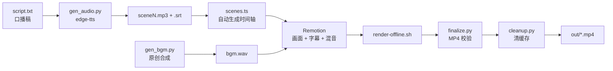

# Easy Video Maker

> 一个从 0 到 1 搭建的**低成本、可复用、可离线渲染**的短视频生产流水线：脚本 → AI 配音 → 原创 BGM → Remotion 信息图 → MP4。
>
> 这套方法由一位家长在两天内实际跑通，产出 **10 条成片 / 34.6 分钟 / 142.6 MB**，并沉淀为文档、CLI 与可复用脚本。内容不涉及任何官方 IP 角色形象、原片画面或主题曲。

[](https://www.python.org/)
[](https://www.remotion.dev/)
[](#)
[](docs/10-copyright.md)

## 它解决什么问题

家长想给低龄孩子做陪看导览视频，但通常卡在三件事：**配音要花钱、动画要软件、音乐有版权风险**。这套流水线用三个替代方案绕开它们：

| 传统做法 | 本方案 | 成本 |
|---|---|---|
| 真人录音 / 商业 TTS | `edge-tts` 神经网络语音 | ¥0 |
| AE / 剪辑软件逐帧做动画 | Remotion + React 写代码出片 | ¥0（本地渲染） |
| 购买或下载 BGM | 纯 Python 原创合成 | ¥0，无采样风险 |

生成的视频不是儿童动画，而是"emoji + 抽象色块信息图 + 配音解说"的导览型内容——既能讲清事实，又不触碰原作视觉素材。

## 目录导航

| 文档 | 内容 |
|---|---|
| [01 · 全景与成果](docs/01-overview.md) | 从 0 到 1 的时间线、10 条成片、技术架构图 |
| [02 · 快速上手](docs/02-quickstart.md) | 环境安装 → 依赖检查 → 第一条片子 |
| [03 · 流水线详解](docs/03-pipeline.md) | 脚本→配音→字幕→时间轴→渲染→校验→清理全链路 |
| [04 · 视觉系统](docs/04-visual-system.md) | 暖纸感编辑台风格、镜头版式、截图素材方法 |
| [05 · BGM 方法论](docs/05-bgm-methodology.md) | 七版迭代教训、分析优先级、给 AI 的 prompt 模板 |
| [06 · 离线渲染与成本](docs/06-offline-rendering.md) | 断网出片指令、token 边界、交接给其他 AI 工具 |
| [07 · 故障排查](docs/07-troubleshooting.md) | 沙箱拦截、类型错误、浏览器锁等真实踩坑表 |
| [08 · AI 协作入口](docs/08-agent-handoff.md) | 给新对话 / 其他 AI 工具的一页操作手册 |
| [09 · 案例研究：11 分钟复盘片](docs/09-case-study.md) | 如何把真实截屏和成片画面剪进视频 |
| [10 · 版权边界](docs/10-copyright.md) | 能用什么、不能用什么、三个常见误区 |

可复用资产：

- `video-toolkit/` — 统一 CLI、环境脚本、依赖清单、参考音频分析器、7 个原创 BGM 生成器
- `examples/template-scripts/` — 新工程脚手架、联网/离线渲染、成片校验、缓存清理脚本
- `examples/script-*.txt` — 两份真实口播稿
- `examples/evidence/` — 真实截屏示例（base64 存档 + 解码脚本，见该目录 README）

## 30 秒理解架构



## 快速开始

```bash
# 1. 安装依赖（仅需一次）
python3 -m pip install -r video-toolkit/requirements.txt

# 2. 加载环境并检查
source video-toolkit/env.sh
video doctor            # 全部 PASS 即可

# 3. 建新工程 → 写 script.txt → 出片
video new demo "我的第一条视频" --profile child
video build ../pawpatrol-demo
```

只需要改画面、或处于断网环境时：

```bash
video offline ../pawpatrol-demo
```

> `env.sh` 中的绝对路径来自原作者的本机工作区。迁移到其他机器时，把 `WB_ROOT` 改为你的工作区根目录即可；详见 [02 · 快速上手](docs/02-quickstart.md)。

## 关键设计原则

1. **音频是真实资产，画面是可重新生成的代码。** 配音只在联网时生成一次；之后所有调色、改版式、换 BGM 都在本地完成，0 token。
2. **第三方音频只作参考，绝不入片。** 分析调性与编制，旋律与和声全部原创。
3. **抽象不等于安全。** 只要观众能从配色 + 品种特征 + 道具认出具体角色，商用仍有实质性相似风险；只做无对应关系的抽象图形。
4. **每轮渲染后清理。** `.tmp/`、in-progress 视频、检查图都不留在工程里。
5. **文档即交接。** 任何新对话或 AI 工具先读 `AGENT.md` 风格的入口页，`doctor` 通过就不要重复安装。

## 版权声明

文档与脚本以 [CC BY-NC-SA 4.0](docs/10-copyright.md) 分享。示例中的口播稿、截屏与成片均为原工作区自制内容；涉及的第三方 IP 名称仅用于事实性介绍与经验分享，**不包含任何官方视觉素材、原片画面或主题曲录音**。请勿将示例素材用于商业发布。

---

*最后更新：2026-11-27 · 作者账号：Enzoanywhere*
